<p align="center">
  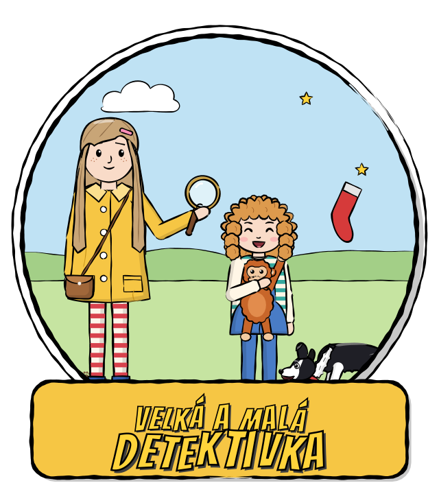
</p>

<h3 align="center">Comics and a point-and-click game, made at home for two small detectives</h3>

<p align="center">
  
  
  
  
</p>

---

This repo is a family project. It holds printed comics and a matching point-and-click game for two
sisters, a big one and a little one. They solve gentle mysteries at their grandparents' cottage, with
a magnifier, a torch, a plush orangutan and a very clever border collie.

The goal is to get kids comfortable on a computer through play: read the comic at bedtime, then
play the same story the next day.

<p align="center">
  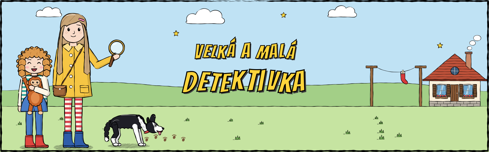
</p>

## 📚 What's inside

| | |
|---|---|
| 🖍️ **Comics** | Hand-inked, printable issues (A4 plus an A5 fold-and-staple booklet). See [`comics/`](comics/). |
| 🎮 **Game** | A Godot point-and-click adventure where every comic issue becomes a playable story. See [`game/`](game/). |
| ✏️ **Art** | All art is **drawn in Python code**, the same library for the comic and the game. See [`art/`](art/). |
| 🗺️ **Plans** | The series plan, the game design and the comic workflow. See [`docs/`](docs/). |

## 🔍 The stories

**Series 1: Velká a malá detektivka** has 16 issues, running from autumn to the next summer. A thread
connects them: grandpa's childhood club, *Klub Hvězdička*. Issues **1–14** are finished as comics and as
playable game stories; 15 *Noc padajících hvězd* and 16 *Klub Hvězdička* are on the way.

Every game story follows its comic and adds puzzles the comic doesn't have: logic puzzles with no way to
lose (undo, try again, ask the dog), and the later stories add more and more reading. Click a story to see it.

<details>
<summary><b>1 · Záhada zmizelých ponožek</b> · <i>The Mystery of the Missing Socks</i></summary>

<p>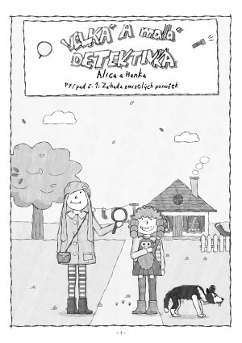 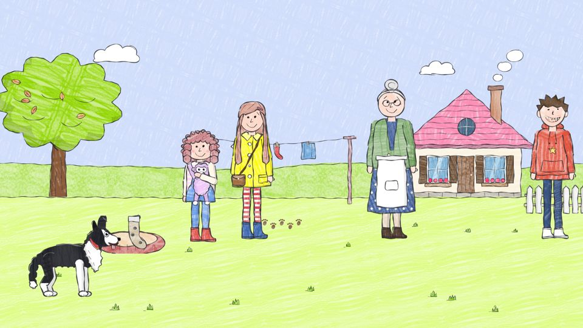</p>

Socks keep vanishing from grandma's washing line at the cottage. Tiny footprints, a flour trap set for the night, and a gap in the fence that only the little sister fits through.

🧩 Nastraž past: push the flour sacks onto the tiny footprints (planning ahead)

</details>

<details>
<summary><b>2 · Tajemství starého klíče</b> · <i>The Secret of the Old Key</i></summary>

<p>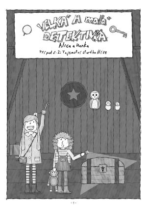 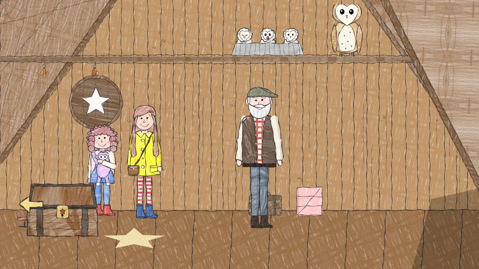</p>

Strange noises from the attic at night, and grandpa doesn't want anyone up there. An old key with a star, a chest from grandpa's childhood club, and owls under the roof.

🧩 Kam svítí hvězdička: turn the mirrors to send the sunbeam to the right plank · counting the planks

</details>

<details>
<summary><b>3 · Mapa ke starému rybníku</b> · <i>The Map to the Old Pond</i></summary>

<p>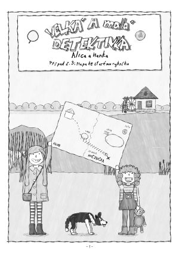 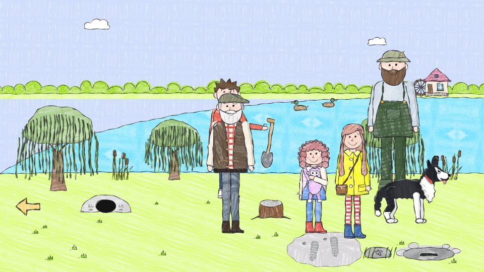</p>

Half of an old treasure map leads to the pond, but someone has dug there first. Footprints in the mud, a quarrel and making up, and a dawn stakeout with the torch.

🧩 Dvacet dětských kroků: plan the steps, then press Go (first programming) · Čí je to stopa? · Kdo to byl?

</details>

<details>
<summary><b>4 · Hanka to vyřeší!</b> · <i>Hanka Will Sort It Out!</i></summary>

<p>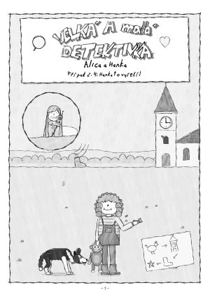 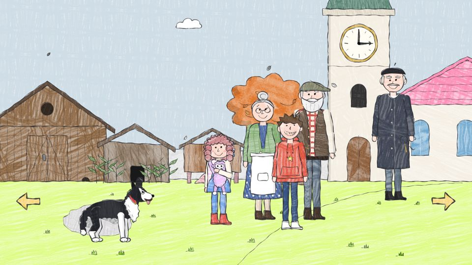</p>

The big sister is ill in bed, so the little one investigates alone, with a walkie-talkie to headquarters. A mysterious letter, a magpie, and the village clock that stopped sixty years ago.

🧩 Rozběhni hodiny: gears turn their neighbours the other way · Navigace vysílačkou: radio the way across the rocks · Kdo šel po stopě?

</details>

<details>
<summary><b>5 · Kdo staví sněhuláky?</b> · <i>Who Builds the Snowmen?</i></summary>

<p>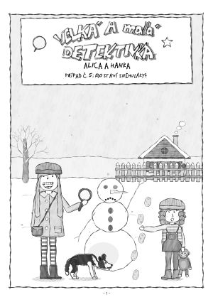 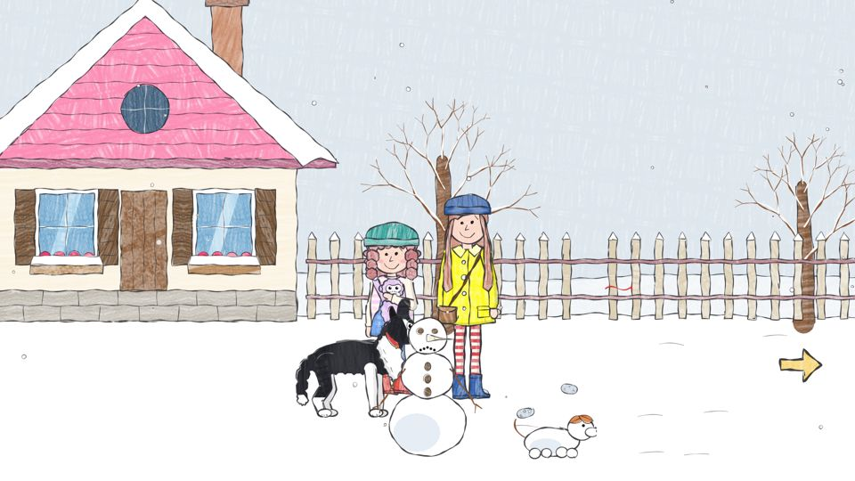</p>

Every morning a new snowman stands in the garden, with a parsnip for a nose. Small boots with stars on the soles lead to someone new in the village.

🧩 Postav sněhuláka: roll the balls on fresh snow · Čí je rukavice? (picture clues) · Kdo staví sněhuláky?

</details>

<details>
<summary><b>6 · Kam mizí perníčky?</b> · <i>Where Do the Gingerbread Stars Go?</i></summary>

<p>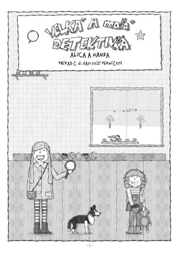 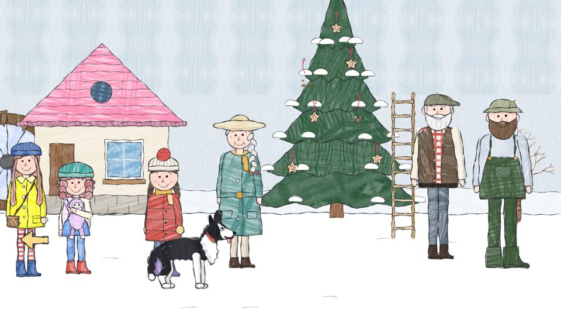</p>

Grandma counts the gingerbread in the tin, and every morning stars are missing. Pecked crumbs on the windowsill, a mousetrap with no bait, and spruce needles on grandpa's boots.

🧩 Hvězdy na smrčku: every row and column gets each ornament once · Kdo co zobe? · Kdo bere hvězdy?

</details>

<details>
<summary><b>7 · Joeyho velký den</b> · <i>Joey's Big Day</i></summary>

<p>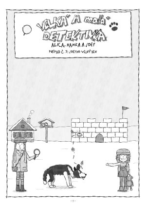 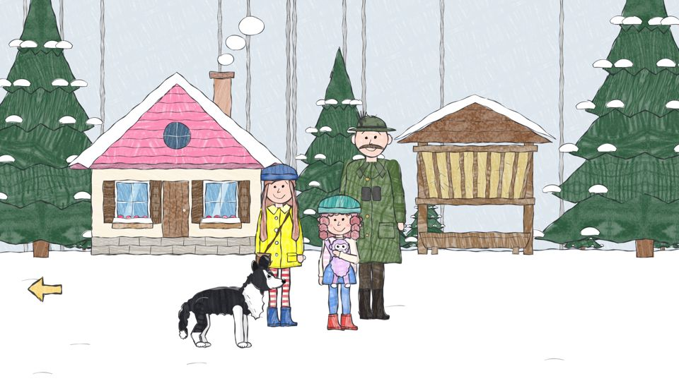</p>

Told by Joey the dog: grandma's ring is gone, and everyone suspects him. Only his nose can put things right.

🧩 Čmuchej!: sniff the snow, warmer or colder · Co se ráno dělo? (put the morning in order)

</details>

<details>
<summary><b>8 · Stopy ve sněhu</b> · <i>Tracks in the Snow</i></summary>

<p>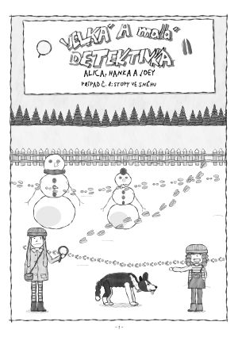 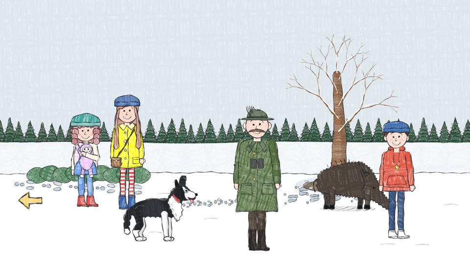</p>

The snowmen keep losing their carrot noses. The gamekeeper teaches the girls to read tracks: hare, fox, boar… and someone else.

🧩 Po stopě: follow only one animal's prints · Seno do krmelce: split the hay evenly (weights)

</details>

<details>
<summary><b>9 · Tajná zpráva v knihovně</b> · <i>The Secret Message in the Library</i></summary>

<p>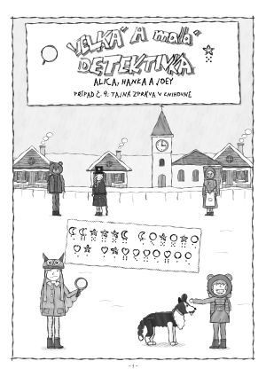 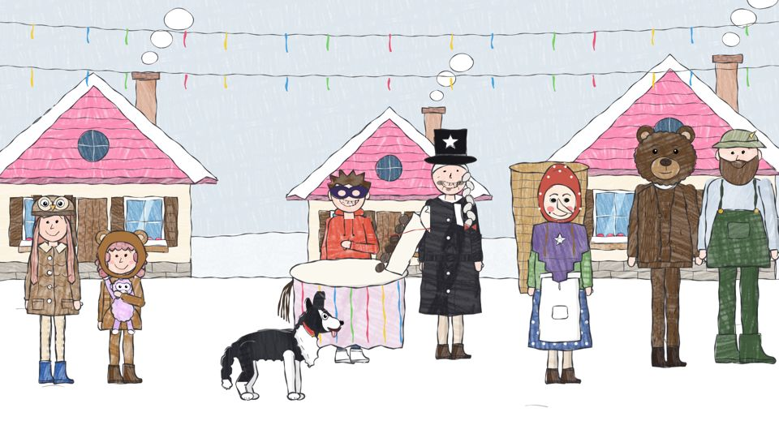</p>

A slip of paper in star code falls out of a library book. Decode it, then find the writer behind a mask at the carnival parade.

🧩 Hvězdičkové písmo: decode and write in the star cipher (reading) · Masopustní průvod: line up the masks

</details>

<details>
<summary><b>10 · Záhada ve škole</b> · <i>The Mystery at School</i></summary>

<p>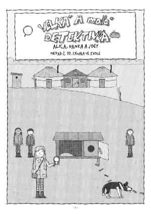 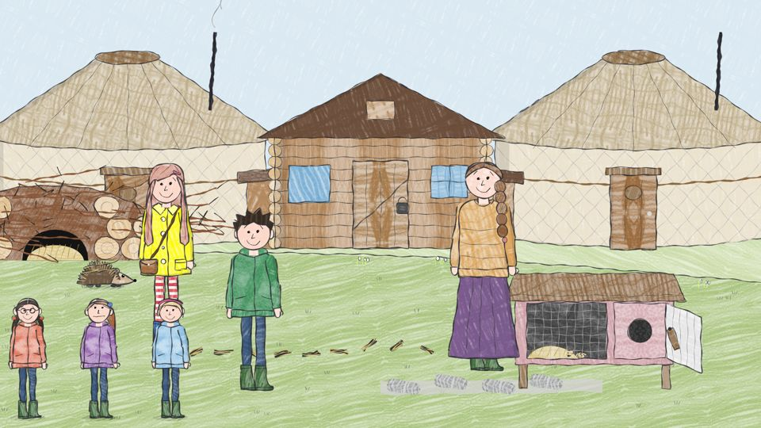</p>

The forest school's guinea pigs are gone from their hutch. A hay trail, a torn note signed K., and two people called Karel.

🧩 Nový kotec: fit the planks into the hutch frame · Ohrádky pro morčata: split the meadow into pens

</details>

<details>
<summary><b>11 · Kam mizí vajíčka?</b> · <i>Where Do the Eggs Go?</i></summary>

<p>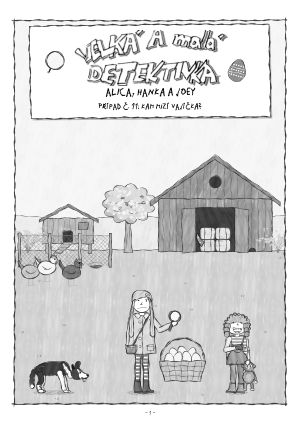 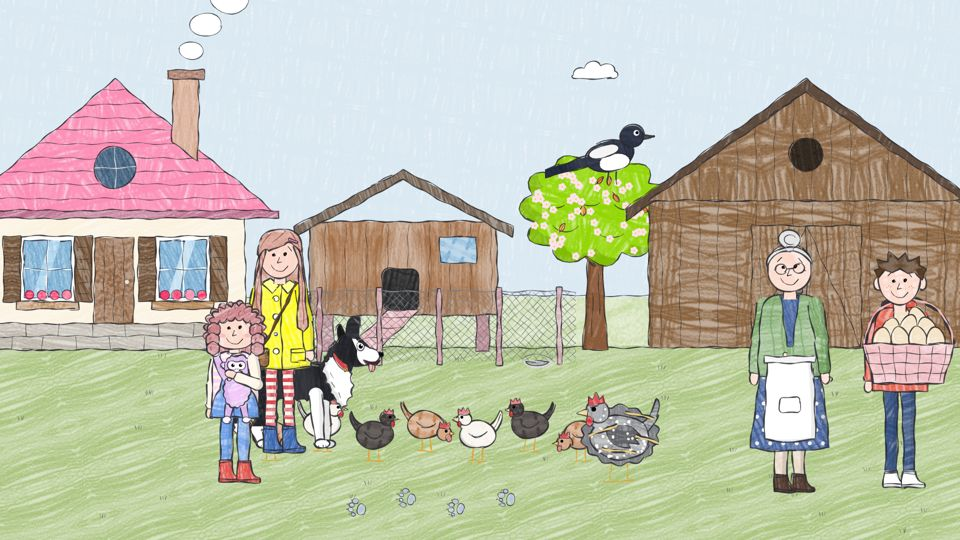</p>

Easter at the cottage: every day one egg is missing from the henhouse. No shells anywhere, a gap under the wire, and straw in one hen's feathers.

🧩 Balíky slámy: slide the bales to open the way · Kraslice podle vzoru: finish the repeating patterns

</details>

<details>
<summary><b>12 · Tajemné šipky</b> · <i>The Mysterious Arrows</i></summary>

<p>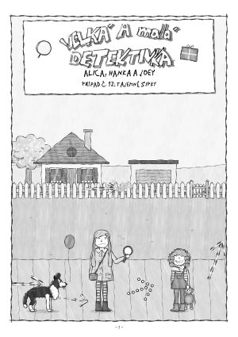 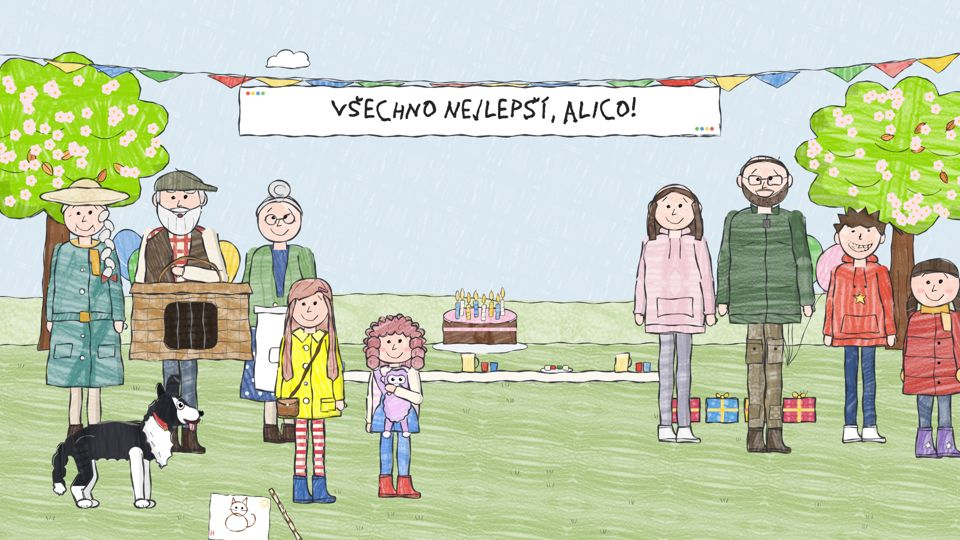</p>

The week before the big sister's birthday, chalk arrows appear everywhere and everyone acts strangely. She investigates her own surprise, and the little sister is in on it.

🧩 Otoč šipky: turn the arrows into one trail past every star · Kdo kde sedí? (seating by the wishes) · who drew which arrow?

</details>

<details>
<summary><b>13 · Stopy u potoka</b> · <i>Tracks by the Creek</i></summary>

<p>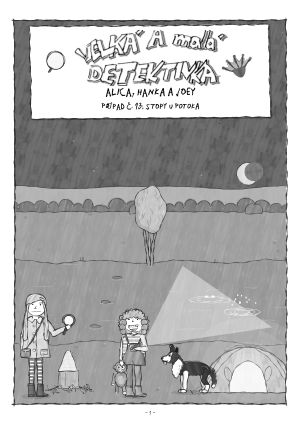 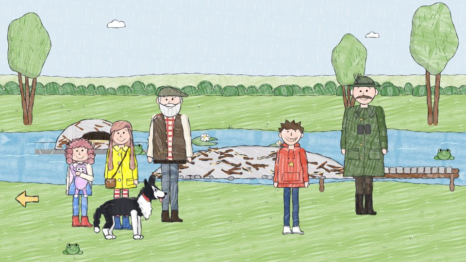</p>

The club camps by the creek. Every night a willow falls, grandpa's walking stick disappears and the stepping stones sink a little deeper.

🧩 Čím to bylo? (match the marks on the wood) · Kámen v potoce: put the drawings in order, read the days, guess tomorrow · Hráz pro bobra: where does the water go? · Pravda, nebo ne? (reading)

</details>

<details>
<summary><b>14 · Poklad na hradě</b> · <i>Treasure at the Castle</i></summary>

<p>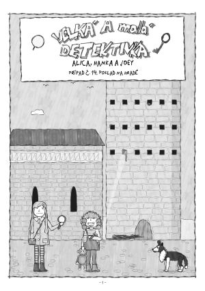 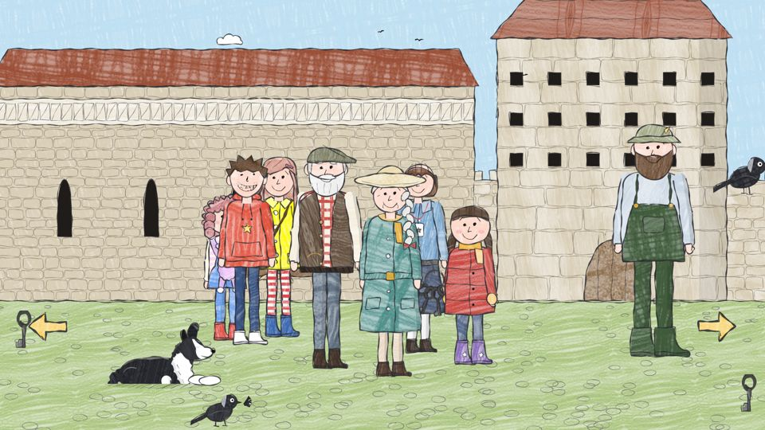</p>

A sleepover at the real castle Točník. The old drawing says XIV, and at night things vanish from the open window of the great hall.

🧩 Klíče od hradu: Roman numerals · Čtrnáctá díra: count the way you read · Jméno pro kavku: spell it, Á is not A · Pravda, nebo ne? (reading)

</details>

Full plan: [`docs/series-plan.md`](docs/series-plan.md). Puzzles per story: [`docs/game-chapters.md`](docs/game-chapters.md).

## 🧸 Made for small hands

- **One click does the obvious thing.** No verb menus. Big hotspots with a hand cursor.
- **Nothing scary, no fail states, no timers.** Every "culprit" turns out to be an animal or a kind person.
- **Stuck? Click the dog.** He sniffs, walks towards the next goal and says *"Čmuch čmuch!"*
- **Both sisters are playable.** Some puzzles need the small one, because only she fits through the fence.
- **Czech and English**, with big hand-lettered subtitles so a grown-up can read along.
- **Saves itself** on every room change.

## 🚀 Run it

You need the portable **Godot 4.6.3** (Popochiu doesn't support 4.7 yet):

```sh
~/apps/godot-4.6/Godot_v4.6.3-stable_linux.x86_64 --path game       # play
~/apps/godot-4.6/Godot_v4.6.3-stable_linux.x86_64 -e --path game    # editor
```

Redraw the art (colour for the game, greyscale for the printer):

```sh
cd art && python -m venv .venv && .venv/bin/pip install -r requirements.txt
.venv/bin/python export_assets.py              # game PNGs -> game/assets/
.venv/bin/python comic_issue1.py               # comic PDF -> comics/
.venv/bin/python readme_art.py                 # this page's logo + banner -> docs/img/
```

The story pictures on this page come from the game itself, drawn headless from the story tests' snapshots
(`--snaps=<dir>`, see [`tools/readme_shots.py`](tools/readme_shots.py)):

```sh
art/.venv/bin/python tools/readme_shots.py <snaps dir>   # -> docs/img/stories/
```

Details on the tech, the repo layout and the conventions are in [`CLAUDE.md`](CLAUDE.md).

## © Licence

**All rights reserved.** This is a private family project, shared here for safekeeping and not for reuse.
See [`LICENSE`](LICENSE). Third-party parts keep their own licences: Popochiu (MIT) and the fonts (SIL OFL 1.1).

---

<p align="center"><sub>Made with ❤️, a magnifier and a lot of missing socks.</sub></p>
